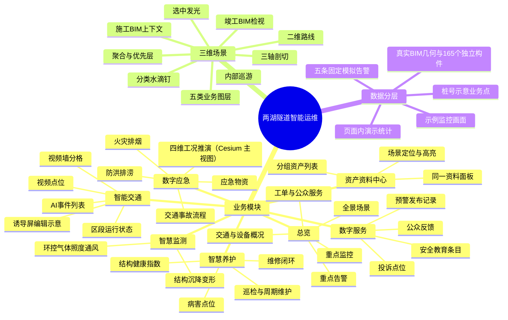
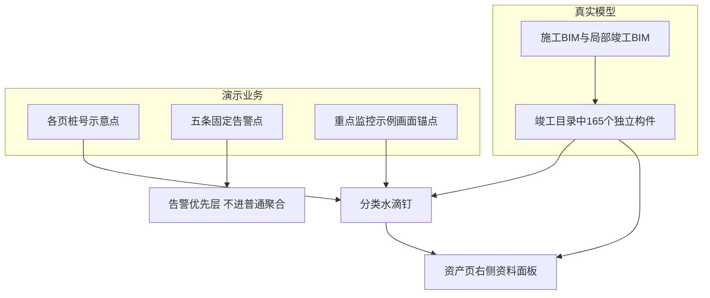

# 产品思维导图

用支持 Mermaid 的编辑器或 GitHub 预览打开。本图描述**当前可演示的前端**，不是远期生产系统架构。

## 1. 总图

## 2. 一次演示怎么串起来

讲解顺序建议从“看见全隧道”走到“拿一份设备资料离开”，中间用告警把模块连上。详细操作见 [使用说明](./01-项目使用说明.md) 第 4 节。

## 3. 模块和场景的关系

七个业务页共用 `TunnelScene`。换页会销毁上一页场景，并按本页重新打开默认图层。手动改过的图层不会带到下一页。

| 模块 | 默认图层 | 业务卡片在场景的哪一侧 |
| --- | --- | --- |
| 总览 | 全部 | 左右悬浮，中间全屏场景 |
| 智能交通 | 交通管控 | 场景在上，视频墙和发布在下 |
| 智慧养护 | 结构监测 | 场景在上，闭环与健康在下 |
| 智慧监测 | 环控系统、结构监测 | 场景在上，气体照明通风结构在下 |
| 数字应急 | 隧道环境、环控系统、隧道机电 | 场景在上，消防排涝事故物资与工况推演在下 |
| 数字服务 | 结构监测 | 场景在上，反馈发布教育在下 |
| 资产资料中心 | 全部 | 左列表、中场景、右资料面板 |

默认分组按各页面原始点位校正，数字服务的投诉点位归入“结构监测”，不再显示空的环境图层。数字应急的四维工况推演直接接管同一个 `TunnelScene` / Cesium 主视图：四个脚本统一驱动步骤、相机、特效、风机气流、情报板、设备状态，以及消防车/疏散车、泵站/绕行车、事故救援/清障/过车的分道演进；车辆逐帧求解净距，不穿模、不压标线或诱导线。进入前保存、退出后恢复相机、图层、气流、透视、漫游与分屏设置。推演读数明确标注为“工况推演值 · 非实时测点”。

图层五组及主要子类：

| 图层 | 典型子类 | 主要出现在 |
| --- | --- | --- |
| 隧道环境 | 上下层结构、管线、通道、泵房、变电所、运管中心 | 各页底图式环境 |
| 环控系统 | CO/VI、风速、照度、烟温火、积水 | 监测、应急 |
| 交通管控 | 车道指示器、情报板、车检、摄像机、紧急电话、广播 | 交通、总览告警 |
| 结构监测 | 腐蚀、螺栓、压力、应力、病害、投诉 | 养护、监测、服务 |
| 隧道机电 | 风机、风阀、风口、消防泵阀、照明、排水泵 | 应急、资产、巡游检索 |

告警横幅只挂在总览、监测、应急。铃铛在所有页都在，点击定位第一条重点告警（积水，K3+050）。

## 4. 点位从哪里来

- 竣工构件的坐标来自包围球和模型变换，不是按桩号百分比摆上去的。
- 病害、投诉、部分监测点和告警是业务示意点，用来讲流程，不能当成竣工模型里的真实设备编号。
- 合并导出的整段灯具没有独立构件号，不单列成设备。
- 告警点、选中点单独一层。聚合数字会避开它们，点击时也优先命中它们。

近景规则：距离任一设备约 45 米以内隐藏 BIM 图标，退到约 65 米以外再显示，避免在临界距离闪烁。巡游时外部图标一律隐藏。

## 5. 数据边界

| 类别 | 当前内容 | 讲解口径 |
| --- | --- | --- |
| BIM 几何、构件号、模型内位置 | 仓库内施工模型与局部竣工模型 | 真实三维数据 |
| 倾斜摄影 | 目录被忽略，缺了就跳过 | 未随包交付，不影响 BIM |
| 在线底图 | 需天地图密钥 | 没有密钥时关底图 |
| 告警五条、工单数、流量、健康指数、物资、反馈 | 前端常量 | 演示数据，不刷新、不入库 |
| 监控缩略图与弹窗 | 仓库示例图片 / GIF，角标写“模拟画面” | 不是实时流 |
| 诱导屏“审核并发布” | 只在当前页表格追加一条 | 刷新即失，未下发设备 |
| 养护“新建任务”、服务“审核 / 新建发布 / 教育专区” | 按钮在界面上 | 没有后续页面和接口 |
| 资产“更新设备 / 维护工单” | 当前页提示成功 | 不写入养护工单表 |
| 孪生工况推演 | Cesium 主视图脚本推演；几何、双层路面与风机来自真实竣工模型 | 不是头显 / WebXR，不读实时测点，不下发设备指令 |
| 账号与权限 | 无登录 | 不讲角色控制已上线 |

产品设想里的 MQTT、GB28181、工单引擎、小程序和值班长审核，保留在源码注释向的需求说明中，**不在本思维导图里算作已交付能力**。
